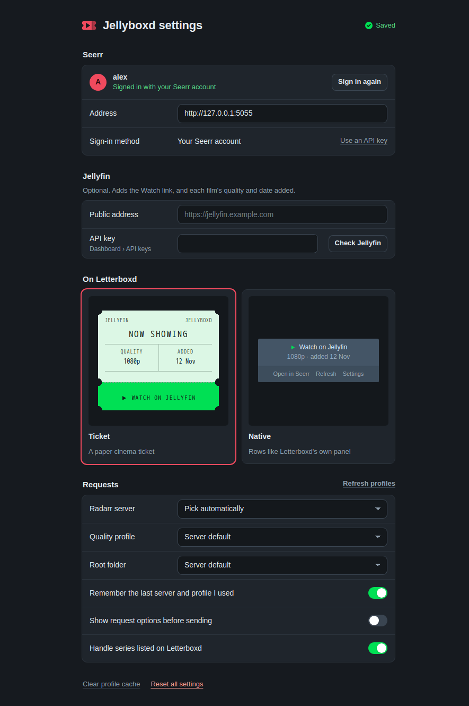

# Jellyboxd

A browser extension that brings your **Seerr** (Jellyseerr, Overseerr) and **Jellyfin** servers to **Letterboxd** film and review pages: see whether a film is on your server, play it, or request it in one click.

Works on Chrome, Edge, Brave, Firefox (128+) and Safari (macOS). Manifest V3, no build step, no third-party dependency.

## Features

- **Availability on film and review pages**: available, downloading, pending, partially available or missing, read from Seerr (and from Jellyfin directly when it is configured).
- **Watch on Jellyfin**: when the film is on your server, the widget shows a single "watch" link that opens it in Jellyfin's web player.
- **Request in one click**: pick the server and the quality profile, both loaded from your Radarr or Sonarr through Seerr. Advanced options cover the root folder, tags and seasons.
- **4K, only if you use it**: when a server is flagged as 4K in Seerr, the widget offers a separate 4K request. Other setups never see it.
- **Follow and cancel requests** from Letterboxd.
- **Seerr only**: without a Jellyfin URL, the widget uses the playback link Seerr provides, or links to the film in Seerr.
- **Set up from Letterboxd**: on any film page, enter your Seerr address and sign in.
- **Your own Seerr account**: you sign in on your Seerr itself, as usual. No admin API key needed, and your password never goes through Jellyboxd.
- **Two widget styles**, chosen in the settings:
  - **Ticket** (default): a paper cinema ticket whose tear-off stub is the main button.
  - **Native**: rows that extend Letterboxd's own actions panel.

## Widget styles

**Ticket** turns the widget into a paper cinema ticket whose stub is the main button.


**Native** extends Letterboxd's actions panel.


## Install

Download the package for your browser from the [latest release](../../releases/latest).

### Chrome, Edge, Brave

1. Unzip `jellyboxd-<version>-chrome.zip`.
2. Open `chrome://extensions` (or `edge://extensions`) and turn on **Developer mode**.
3. Click **Load unpacked** and select the unzipped folder.

### Firefox

The `.xpi` file is not signed by Mozilla yet.

- **Firefox Developer Edition or Nightly**: set `xpinstall.signatures.required` to `false` in `about:config`, then open the `.xpi` file.
- **Firefox (release)**: open `about:debugging#/runtime/this-firefox`, click **Load Temporary Add-on…** and select the `.xpi`. The add-on stays until Firefox restarts.

### Safari (macOS)

The Safari app is built without an Apple signature.

1. Unzip `jellyboxd-<version>-safari-macos.zip` and move **Jellyboxd.app** to Applications.
2. In Safari, turn on **Settings → Advanced → Show features for web developers**, then **Develop → Allow Unsigned Extensions**.
3. Open Jellyboxd.app once, then enable the extension in **Safari → Settings → Extensions**.

Safari turns off unsigned extensions when it quits, so step 2 has to be repeated after each restart. You can also build and sign the app yourself from the Xcode project in `safari/`.

## Setup

1. Open any film on Letterboxd. Jellyboxd shows under the actions panel and asks for your Seerr address.
2. Enter it and click **Continue**. A small Jellyboxd window opens.
3. Choose how to sign in:
   - **Your Seerr account** (recommended): click **Sign in on Seerr**, allow access, and sign in on the Seerr tab that opens, as you usually do. The window notices it by itself.
   - **API key**: for Seerr administrators. Paste the key from Seerr › Settings › General.
4. Optional, in the settings (toolbar icon › **Settings**): add your public Jellyfin address for the **Watch on Jellyfin** link, and a Jellyfin API key to show each film's quality and date added. Pick the widget style there too.



## Troubleshooting

- **Signed out right after signing in**: make sure you signed in on the same address as the one in Jellyboxd's settings (for example `https://` rather than `http://`).
- **Signed out on Safari behind a reverse proxy**: sign in again from the Jellyboxd window and allow both the `https://` and `http://` access it asks for. If your proxy sends `X-Forwarded-Proto`, turning on **Enable Proxy Support** in Seerr › Settings › Network also fixes it and keeps the session cookie on https only.
- **No quality profiles**: your Seerr account needs the `REQUEST_ADVANCED` permission to list them; without it, requests still go through with Seerr's default profile.
- **Nothing shows on Letterboxd**: the widget only appears on film pages (`https://letterboxd.com/film/...`) and reviews (`https://letterboxd.com/<member>/film/...`) of films that have a TMDB id.

## Development

```bash
python3 scripts/build.py    # dist/chrome, dist/firefox, dist/jellyboxd-chrome.zip, dist/jellyboxd-firefox.xpi
python3 scripts/verify.py   # referenced files, JSON, and JS syntax when Node.js is installed
```

Load the repository root as an unpacked extension in Chrome while working: `manifest.json` at the root is the Chrome manifest.

| Path | Content |
|---|---|
| `manifest.json`, `src/`, `icons/` | The extension. |
| `src/content/` | The widget injected into Letterboxd film and review pages. |
| `src/background/` | Seerr and Jellyfin API clients, settings and cache. |
| `src/options/`, `src/popup/`, `src/setup/` | Settings page, toolbar popup and sign-in window. |
| `platforms/firefox/overrides.json` | Keys replaced in the manifest for Firefox (`background.scripts`, `browser_specific_settings`). |
| `safari/` | Xcode project wrapping the extension for Safari. |
| `scripts/` | Build and checks (Python 3, standard library only). |

## Privacy

Jellyboxd only talks to the Seerr and Jellyfin servers you set up, and collects nothing. See the [privacy policy](PRIVACY.md).

## License

[MIT](LICENSE)
